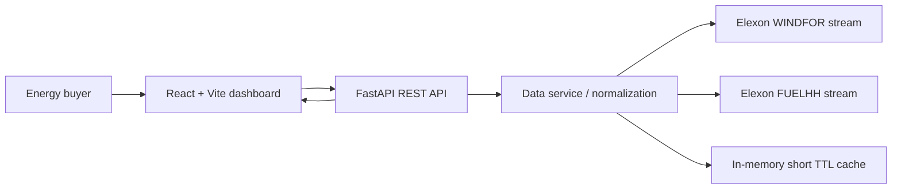

# Wind Insight — UK Day-Ahead Wind Forecast Decision Portal

React + FastAPI app for viewing national UK wind generation forecasts and evaluating forecast error for January 2026. It uses Elexon BMRS `WINDFOR` and `FUELHH` streams.

## Features
- Latest forecast snapshot per 30-minute delivery period, constrained to publication timestamps available before the delivery day.
- Actual vs forecast chart and interval-level table.
- MAE, RMSE, bias, and WAPE summary.
- January 2026 date filters and CSV export.
- Clearly labeled demo mode if upstream Elexon data cannot be fetched.

## Architecture


## Requirements
- Docker + Docker Compose, or Node.js 20+ and Python 3.11+
- Network access for upstream Elexon data (optional; demo fallback exists)

## Run with Docker
```bash
docker compose up --build
```
Open http://localhost:8080

## Run locally
Terminal 1:
```bash
cd backend
python -m venv .venv
.\.venv\Scripts\Activate.ps1
pip install -r requirements.txt
python -m uvicorn app.main:app --reload --port 8000
```
Terminal 2:
```bash
cd frontend
npm install
npm run dev
```
Open http://localhost:5173

## API
- `GET /api/health`
- `GET /api/dashboard?month=2026-01`
- `GET /api/intervals?date=2026-01-12`
- `GET /api/export?month=2026-01` (CSV)

## Data and methodology
- Actuals: `FUELHH`, filter `fuelType == "WIND"`, fields `startTime`, `generation`.
- Forecast: `WINDFOR`, fields `startTime`, `publishTime`, `generation`.
- A delivery interval is 30 minutes. The dashboard selects the most recent forecast published before the delivery day cutoff (00:00 UK local time on delivery date). Forecast error is forecast minus actual.
- Metrics are calculated only over matched actual/forecast periods. Missing data is excluded, not imputed.
- `WAPE = sum(abs(error)) / sum(actual) * 100`; undefined if total actual is zero.
- This is a pilot analysis, not a trading recommendation. Check upstream publication conventions and DST handling before production decisions.

## Deployment
- Frontend: deploy `frontend` to Vercel. Set `VITE_API_BASE_URL` to a publicly reachable API URL.
- Backend: deploy `backend` as a Docker web service (Render/Fly.io/Heroku-compatible platform). Set CORS origins in `CORS_ORIGINS`.
- For a single-origin Docker deployment, compose serves the static frontend via nginx and proxies `/api` to FastAPI.
- Never expose private credentials in Vite variables.

## Testing
```bash
cd backend
pip install -r requirements.txt
pytest -q
```
Manual checks: loading state, upstream unavailable, empty periods, CSV export, metric consistency, timezone/day-boundary and daylight-saving dates.

## AI tool disclosure
AI assistance was used to scaffold and draft portions of this application and documentation. Review, test, and validate before operational use.
